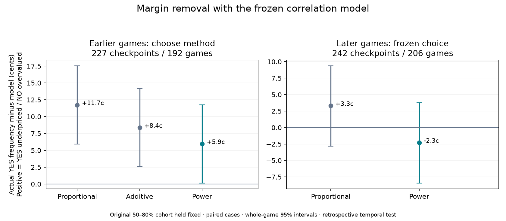

# NBA combo pricing

A market-anchored pricer for full-game NBA same-game combinations, with calibration studies and cash-limited NO-maker replays.

The system takes probabilities for individual legs from verified market references, evaluates all legs on shared simulated game outcomes, and reweights those outcomes to match the supplied leg probabilities. The research asks whether the resulting combinations are calibrated, which historical trades a quote would beat, and how fees, trade sizes and game limits change the result.

**Current finding:** broad average calibration can look reasonable while selected fills have substantial errors. Moneyline × total in Q4 is the clearest example. Historical profitability remains uncertain.

[Findings](docs/findings.md) · [Methodology](docs/methodology.md) · [Data and reproduction](docs/data.md) · [Model card](models/MODEL_CARD.md)

## Run it locally

Python 3.11 or newer is required. From the repository root:

```bash
python -m venv .venv
# Activate .venv using your shell's activation command.
python -m pip install -e ".[dev]"
python -m nba_combo_pricing.demo
python -m nba_combo_pricing.backtest examples/illustrative_trades.jsonl --premium-cents 3
python -m pytest
python analysis/render_figures.py
```

The demo uses the bundled frozen model and a deliberately illustrative game state with fictional player identifiers. It requires no account, API key or network request. The example trades are also illustrative; their output is not a historical performance result.

For the bundled RFQ, the independent leg product is **31.20%** and the correlated estimate is approximately **30.57%**, using two seeds with 4,096 paths each. Run the demo to inspect the seed disagreement and quote status.

Price a normalized RFQ directly:

```bash
nba-combo-price --input examples/illustrative_rfq.json --model models/fitted_model.npz
```

## What is included

| Component | Purpose |
|---|---|
| `src/nba_combo_pricing/pricer.py` | Verified leg normalization, exact contradiction checks, shared-path pricing and marginal anchoring |
| `src/nba_combo_pricing/simulator.py` | Remaining-game player minutes, scoring and statistical outcomes on coherent paths |
| `src/nba_combo_pricing/state.py` | Observed game-state representation and historical reconstruction helpers |
| `src/nba_combo_pricing/references.py` | Strict as-of midpoint checks and three two-sided margin-removal assumptions |
| `src/nba_combo_pricing/backtest.py` | Historical price-comparison replay with sizes, historical fee inputs and one shared game cash cap |
| `src/nba_combo_pricing/calibration.py` | Whole-game bootstrap intervals and earlier-game method selection |
| `results/` | Aggregate study outputs, coverage, uncertainty and provenance |
| `models/` | Frozen numeric inference artifact and model card |

Supported leg types are moneyline, spread, game total, player points, rebounds, assists and made threes. Legs must resolve to verified contracts in the same game. A supported combination is structurally priceable; it is not automatically well calibrated. Possible nonbinary player payouts, missing anchors, incompatible simulation support and excessive seed disagreement produce explicit statuses.

## Study coverage

| Study population | Observations | Independent games |
|---|---:|---:|
| Consolidated eligible actual trades, all families | 28,064 | 1,233 |
| Moneyline × total actual trades | 20,496 | 1,040 |
| Spread × total actual trades | 1,349 | 138 |
| Synthetic spread × total checkpoints | 3,792 | 1,056 |
| Expanded player-prop trades with both legs undecided, Q3–Q4 | 14,473 | 382 |

These populations overlap and use different sampling rules. They must not be summed. Synthetic checkpoints use real historical lines, states and outcomes, but supply no executions or P&L. Four complementary tickets from one checkpoint share the same outcome.

## Selected results

**Moneyline × total:** actual-size-weighted NO overvaluation on simulated fills was **1.44c at a 2c premium** and **2.03c at 3c**. In Q4 it was **7.81c and 11.81c**. Removing correlation on those same Q4 fills changed the errors to **7.72c and 11.66c**. This points toward reference probabilities and selected-fill behavior as important suspects; it does not establish a unique causal explanation.

**Margin removal:** power removal won an earlier-game comparison for the original 50–80% spread-cover + over cohort. On strictly later-date games, it changed average YES underpricing of **3.30c** to overpricing of **2.30c**. The improvement in the prediction score was not statistically clear.



**Premiums:** adding the previously observed average miss to every moneyline × total quote reduced competitive historical opportunities by **35–47%**. The remaining fills had larger observed pricing errors, and net family P&L fell in that retrospective comparison.

See [the findings](docs/findings.md) for confidence intervals, quarter-level results, excluded cases and comparisons that did not improve the model.

## How to interpret the results

- A midpoint and a no-vig sportsbook probability are reference estimates, not observed true probabilities.
- “Fill” means a simulated quote strictly improved an actual historical traded price and passed the game cash limit. It does not mean a live RFQ accepted that quote.
- A positive **NO overvaluation** is observed YES payout frequency minus predicted YES probability. It measures an adverse NO pricing gap before premium and fees.
- Confidence intervals resample whole games. Quarter and family investigations are exploratory and are not adjusted for testing many groups.
- The historical games were inspected during research. The chronological method-selection exercise is retrospective validation, not a pristine prospective holdout.

The release includes aggregate results and fitted numeric model arrays. Raw provider responses, order-book histories, credentials, account activity and collection infrastructure are excluded. [Data and reproduction](docs/data.md) explains which results can be rerun from this checkout and what additional data an independent historical rerun requires.

MIT licensed. The project is independent of the referenced sports and market-data providers.
