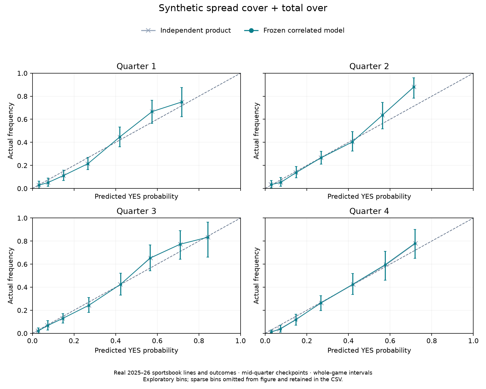
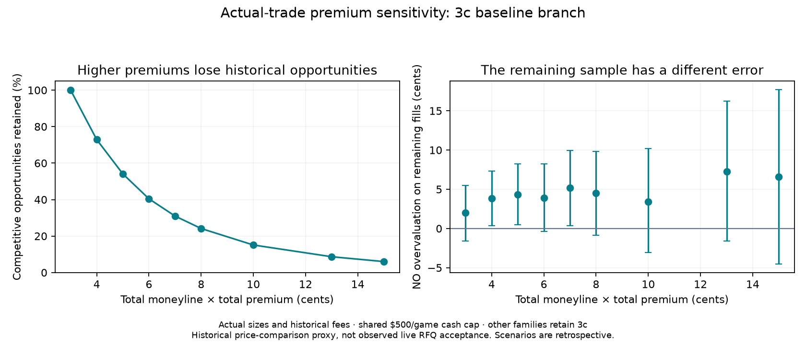

# Findings

Results below are from the 2026-11-19 research snapshot. Each population has its own selection and weighting rules; counts are not additive. Linked aggregate files contain the corresponding rows and uncertainty.

## Actual-trade replay

The consolidated replay contains 28,064 eligible actual trades across 1,233 games. Moneyline × total provides 20,496 trades across 1,040 games; spread × total provides 1,349 across 138. Trades do not require candles when another eligible reference is available.

Using actual sizes, historical fee inputs and one shared $500 game cap:

| Family | 2c net P&L | 3c net P&L |
|---|---:|---:|
| All families | −$1,147 | +$5,303 |
| Moneyline × total | +$2,977 | +$4,474 |
| Spread × total | −$1,964 | −$1,325 |

The overall 95% game-bootstrap ranges are approximately **−$17,892 to +$15,376** at 2c and **−$11,739 to +$22,314** at 3c. The data does not establish reliable profitability. The premiums are exploratory scenarios, not independently validated live policies.

Source: [real trade backtest](../results/real_trade_backtest.csv).

## Family and quarter matter

At a 3c premium, the maker-fill scorecard is:

| Family | Q1 NO error | Q2 NO error | Q3 NO error | Q4 NO error |
|---|---:|---:|---:|---:|
| Moneyline × total | +1.7c / 541 games | −2.3c / 480 | +2.4c / 321 | +11.8c / 243 |
| Same-player points × threes | +8.9c / 85 | +15.1c / 44 | −0.9c / 49 | −11.5c / 27 |
| Spread × total | +23.6c / 19 | −1.1c / 25 | −7.8c / 22 | +25.8c / 25 |
| Points × points | −24.4c / 25 | 11 filled games | 8 filled games | 2 filled games |
| Moneyline × points | −24.5c / 22 | 9 filled games | 10 filled games | 6 filled games |

Positive means NO overvaluation, before premium and fees. Most cells have wide confidence intervals. Moneyline × total Q4 is the clearest adverse signal; same-player points × threes Q2 is also concerning, particularly at 2c, where its miss is 27.3c across 54 games. Large spread × total estimates rely on small filled-game samples.

Points × points and moneyline × points in Q1 show conservative NO errors. These remain calibration problems even though the direction does not explain NO overpayment.

Source: [complete 2c/3c family-quarter scorecard](../results/family_quarter_maker.csv). Reported subgroup intervals are exploratory, with no multiple-comparison adjustment. A confidence range containing zero does not establish that a quarter is safe.

## Correlation ablation on the same fills

Removing correlation leaves moneyline × total's observed average miss nearly unchanged:

| Maker-fill sample | Correlated NO error | Independent-product NO error |
|---|---:|---:|
| All quarters, 2c | +1.44c | +1.44c |
| All quarters, 3c | +2.03c | +2.02c |
| Q4, 2c | +7.81c | +7.72c |
| Q4, 3c | +11.81c | +11.66c |

For this family and these selected fills, the marginal references and historical fill selection deserve attention before a wholesale change to the dependence model. This average comparison does not establish that every direction or tail is correctly modeled. Accounting decompositions into leg and joint residual terms are diagnostic identities, not unique causal attributions.

Source: [same-fill ablation](../results/same_fill_correlation_ablation.csv); Q4 values aggregate the same source/family/quarter diagnostic groups recorded in the original study.

## Expanded player-prop calibration

A separate 2025–26 study added 14,473 priceable Q3–Q4 actual trades across 382 games with both legs still undecided. Across this population, YES was overpredicted by **7.32c**, with a 95% game-bootstrap range of **4.78–10.12c**. Q3 was +6.03c and Q4 +10.38c.

This corresponds to NO underpricing, the conservative direction. It is measured across all newly priceable trades, not the maker-selected fills above. The different populations can have different error directions.

Examples include points × points: NO underpricing of approximately 5.0c in Q3 across 311 games and 11.4c in Q4 across 185 games. Same-player points × threes in Q3 shows 16.1c of NO underpricing across 90 games. A family can therefore look close on a small selected-fill subset while remaining miscalibrated in a broader study.

Source: [expanded player-prop results](../results/expanded_player_prop_calibration.csv).

## Synthetic spread × total: more independent games

Outcome-blind mid-quarter checkpoints produced 4,077 candidates across 1,057 games from 2025–26. At the current simulation precision, 3,792 checkpoints across 1,056 games were priceable. Exclusions were 260 seed disagreements, 21 incompatible supports and four sample boundaries; they remain counted in coverage.

For selected-team cover + over, the mean prediction was **24.81%** and observed frequency **24.34%**. YES overprediction was **0.47c**, with a 95% game-bootstrap range of **−0.80 to +1.72c**. That average hides probability-dependent gaps:

| Original predicted band | Checkpoints | Games | Mean prediction | Actual frequency |
|---|---:|---:|---:|---:|
| 50–65% | 296 | 266 | 56.95% | 63.85% |
| 65–80% | 175 | 163 | 71.46% | 80.00% |

These are exploratory bins. The synthetic study supplies calibration labels, not traded prices, fill probabilities or P&L. It tests selected mid-quarter checkpoints and does not establish accuracy in the final minutes.

Sources: [coverage](../results/synthetic_spread_total_coverage.csv), [directional calibration](../results/synthetic_spread_total_calibration.csv), [reliability bins](../results/synthetic_reliability_bins.csv).

## Margin removal and a frozen later test

Exact archived quote reconstruction passed for all 471 original 50–80% cases across 400 games. Both legs used alternate markets, with average bookmaker margins around 7.2%. Converting those quoted odds to fair probabilities materially changes the combined price.

Earlier-game equal-game Brier scores were 0.20449 for proportional removal, 0.19697 for additive and 0.19318 for power. Power was frozen before later pricing. All methods in the earlier comparison and both primary later methods passed the original numerical guards.

On 242 strictly later-date cases across 206 games:

| Method with unchanged correlation model | Predicted YES | Actual frequency | YES underprediction |
|---|---:|---:|---:|
| Proportional | 62.82% | 66.12% | +3.30c |
| Frozen power | 68.42% | 66.12% | −2.30c |

The error ranges were −2.85 to +9.36c for proportional and −8.44 to +3.77c for power. Power's equal-game Brier improvement was 0.00180, with a paired 95% change range of −0.00829 to +0.00502; lower scores are better. A small point-estimate improvement is not a confirmed improvement.

Source: [frozen choice](../results/frozen_margin_choice.json) and [paired temporal results](../results/margin_removal_walkforward.csv). The original cohort stays fixed; the study does not re-bin favorable cases under the new method.

## Quote age and possible stale information

In the later spread × total sample, oldest included book updates were typically 34–36 seconds old; newest updates were typically 12–14 seconds old. In 58 of 238 combinations with auditable update-time score comparisons, at least one leg's newest quote timestamp preceded a recorded score change.

On 177 matched cases across 166 games, using only books updated within 30 seconds changed the correlated power price by −0.22c on average. Its prediction score did not clearly improve. Using only the newest available book update(s) changed the full later-sample price by −0.03c on average.

Some inputs are exposed to changing game information, but the freshness comparisons do not explain the large original gap. Market timestamps are not proof of price-change time. Nearby five-minute snapshots provide limited exact-line coverage and include ordinary game evolution, so their movements cannot identify staleness by themselves.

Sources: [quote-age audit](../results/quote_age_audit.csv), [paired freshness reprices](../results/margin_removal_walkforward.csv), [nearby cached snapshot checks](../results/nearby_snapshot_changes.csv).

## Premiums change the sample

Applying the full-sample average NO miss as an extra premium to moneyline × total gave:

| Change | Competitive opportunities lost | Filled contracts lost | Net family P&L |
|---|---:|---:|---:|
| 2c to 3.44c | 34.7% | 15.7% | +$2,977 to +$1,284 |
| 3c to 5.03c | 46.5% | 30.9% | +$4,474 to +$2,532 |

NO overvaluation on the remaining fills increased from 1.44c to 3.17c and from 2.03c to 4.26c, respectively. Increasing the premium does not simply cancel the old sample's average miss. The observed P&L changes have wide uncertainty.

A Q4-only increase from 3c to 14.81c removed 86.4% of competitive Q4 opportunities and reduced Q4 losses from $5,039 to $317. Skipping Q4 entirely produced slightly higher full-family P&L than that wide-premium policy. These outcomes were evaluated on the same archive used to identify the misses and do not constitute validated policies.

Sources: [premium scenarios](../results/premium_sensitivity.csv), [quarter results](../results/premium_sensitivity_by_quarter.csv), [Q4 skip comparison](../results/q4_skip_comparison.csv).

## Open questions

The next controlled studies should focus on fresh, tight, verified references for moneyline × total Q4, retain the same dependence model, and evaluate on additional games. Shadow quotes should retain lost requests as well as accepted ones so the historical fill proxy can be checked against actual competition. Dependence errors by direction and probability band remain relevant even when overall ablations are small.
